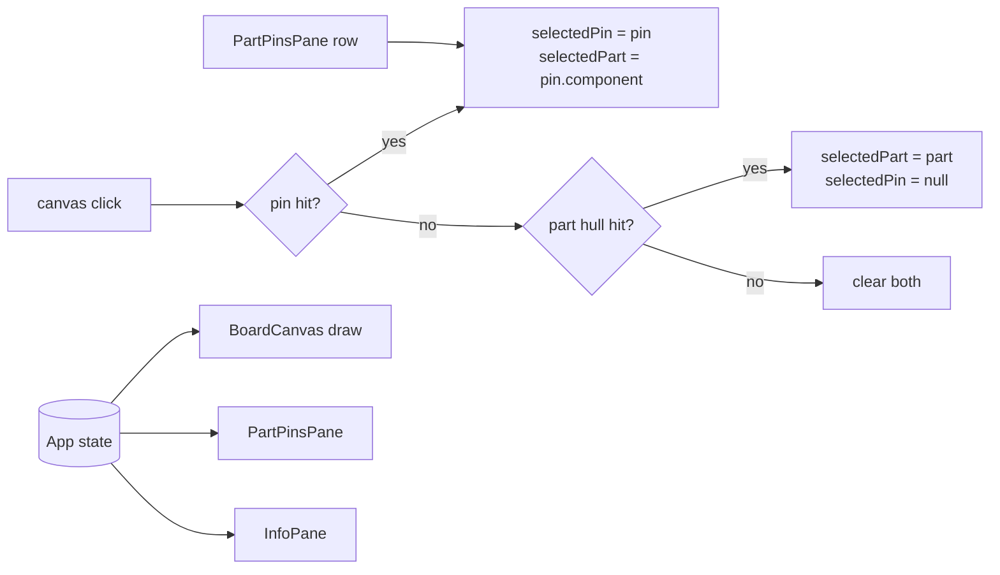

# Web — Part Click Selection + Part Pin List

> **For agentic workers:** track tasks with `- [ ]` checkboxes. Implement strictly web-side; no server/API change is required.

**Goal:** Clicking a component hull on the web canvas highlights the whole part (hull fill + outline + pin rings/labels) and opens a list box of that part's pins in the right panel; clicking a row in that list selects that pin exactly like a canvas pin click.

**Desktop reference:** `src/openboardview/BoardView.cpp`
- hull hit-test + selection: `BoardView.cpp:1915-1970`
- clear on empty click: `BoardView.cpp:1994-2000`
- part highlight fill/outline: `BoardView.cpp:3443-3445`
- "part of selected pin is highlighted too": `BoardView.cpp:4328-4334` (`PartIsHighlighted`)
- per-part pin list box: `BoardView.cpp:540-570`
- selected-part pins get text + ring on desktop: `BoardView.cpp:2873-2897` — **not ported**: part selection only highlights the hull, pins stay untouched

## Current state (evidence)

- Web selection is pin-only: `App.tsx:37` (`selectedPin`), `BoardCanvas.tsx:490-492` (`hitTestNearestPin` → `onSelectPin`).
- No hull hit test: `web/src/scene/hitTest.ts` only exposes `hitTestNearestPin`.
- Part highlight is outline-only: `draw.ts:543-556`; pins of a highlighted part only get labels (`draw.ts:894`); selected pin's part outline is drawn twice (`draw.ts:775-790`).
- Board JSON already has everything: `Component.pins` is an array of **pin ids** (`src/obv_core/src/board_json.cpp:545-556`), ids are `<component>.<number>` / `nail.<number>.<i>` (`board_json.cpp:145-155`), and every pin row carries `id/component/number/name/show_name/type/netId/pos`.
- Right panel is pin-driven: `InfoPane.tsx` renders only when `selectedPin != null`.

## Non-goals

- Multi-part selection (desktop `Ctrl` toggling). One selected part at a time.
- Part search turning into a pin list for all matches (typing still only highlights).
- Any overlay write from the part pane (read-only).
- Server route additions (`/parts/:part` is not needed for this UI).

## Design decisions

| Decision | Choice | Why |
|---|---|---|
| Selection state | `selectedPartName: string \| null` + existing `selectedPin` | Keeps pin channel intact, adds a part channel. |
| Part of a selected pin | `selectedPartName = pin.component` | Desktop `PartIsHighlighted` treats a selected pin's part as highlighted. |
| Hull click | `selectedPartName = name`, `selectedPin = null` | Desktop clears pin selection when the click lands on a hull. |
| Empty click | clear both | Desktop `BoardView.cpp:1994-2000`. |
| Overlapping hulls | topmost = last entry in `board.components` that contains the point | Matches draw order (`drawParts` iterates forward); desktop multi-selects, we pick the one visible on top. |
| GND / NC pins in the list | hidden (filtered out) | They cannot be selected as signal pins (`isNonSelectablePin`, `BoardCanvas.tsx:275`); dead rows only add noise. List count reflects the filtered rows. |
| Search interaction | only an explicit *part* result click sets `selectedPartName` | Typing fires `onSelectionChange` on every keystroke (`SearchBox.tsx:46-49`); it must not thrash the pin list. |

## Data flow



## Tasks

### Task 1 — `hitTestComponent` + tests

**Files:** `web/src/scene/hitTest.ts`, `web/src/scene/hitTest.test.ts`

Add, next to `hitTestNearestPin`:

```ts
/**
 * Topmost component hull whose outline contains the screen point.
 * Port of desktop BoardView.cpp:1929-1937 (ray casting); skips type
 * `board`/`dummy` and parts not on the visible side.
 */
export function hitTestComponent(
  board: BoardDocument,
  view: ViewState,
  sx: number,
  sy: number,
  cssW: number,
  cssH: number,
): Component | null;
```

- `screenToBoard` once, then loop `board.components ?? []`.
- Reuse the file-local `sideVisible`.
- Skip `outline.length < 3`, `type === 'board'`, `type === 'dummy'` (lower-cased).
- Keep the last match (array order = draw order = topmost).
- Ray-cast predicate exactly as desktop (guards against `poly[b].y - poly[a].y === 0` via the `>`/`<` half-open condition — same expression, do not "simplify").

Tests (extend `hitTest.test.ts`; add a `makeComponent` helper):

- inside axis-aligned square → name returned; outside → `null`.
- part on `bottom` side while view is `top` → `null`.
- `type: 'board'` → `null`.
- two nested outlines: later array entry wins.
- outline with 2 points ignored.

### Task 2 — draw selected part

**Files:** `web/src/scene/draw.ts`, `web/src/scene/BoardCanvas.tsx`

- `DrawHighlight`: add `selectedPartNames?: ReadonlySet<string>`.
- `DrawColors`: add `partSelectedFill` (`rgba(255, 224, 130, 0.18)`), keep `partHighlight` for stroke.
- `drawParts` (`draw.ts:528`): `selected = highlight.selectedPartNames?.has(part.name)`; fill = `selected ? partSelectedFill : partFill`; stroke selected/highlighted with `partHighlight` at width 2.
- `drawPins` / `drawPinLabels`: **unchanged** by part selection — no rings, no forced labels for the clicked part. Pin visuals stay driven by pin selection / search / same-net only.
- `drawPartLabels`: selected part name uses `colors.partHighlight`.
- `drawHighlights` (`draw.ts:754`): delete the part outline block (771-790); the pin halo stays. `drawParts` now owns part outlines.
- `BoardCanvas`: prop `selectedPartName?: string | null`; in the draw effect build `selectedPartNames` from `selectedPartName` plus the part of `selectedPinId`; `partNames` keeps its existing pin-selection entry so pin-selection visuals do not change. Pass both to `drawBoard`.

### Task 3 — click routing in `BoardCanvas`

**Files:** `web/src/scene/BoardCanvas.tsx`

- New prop `onSelectPart?: (partName: string | null) => void`.
- In `endPointer` click path (`BoardCanvas.tsx:488-492`):
  ```ts
  const pin = hitTestNearestPin(board, v, x, y, size.w, size.h);
  if (pin) { onSelectPin?.(pin); return; }
  const part = hitTestComponent(board, v, x, y, size.w, size.h);
  onSelectPart?.(part?.name ?? null);
  ```
- Hover hit test and context menu stay pin-only.
- Optional (cheap): status bar shows `part` name when `selectedPartName && !selectedPin`; skip if it complicates layout.

### Task 4 — `PartPinsPane`

**Files:** new `web/src/ui/PartPinsPane.tsx`, `web/src/index.css`

```ts
export interface PartPinsPaneProps {
  board: BoardDocument;
  overlay?: OverlayDocument | null;
  partName: string | null;
  selectedPin: Pin | null;
  onSelectPin: (pin: Pin) => void;
  onClear: () => void;
}
```

- `pinById` memo over `board.pins`; `part` = `components.find(c => c.name === partName)`.
- Rows: `part.pins` ids mapped through `pinById`, filtered non-null; fallback to `board.pins.filter(p => p.component === partName)` when `part.pins` is empty. Preserve board-file order.
- Header: part name, `N pin(s)`, mfgcode/type/side line, close button (`×`, `aria-label="Clear part selection"`, calls `onClear`).
- List box: `<ul role="listbox" aria-label="Part pins">`, one `<button role="option" aria-selected={pin.id === selectedPin?.id}>` per row.
- Filter rows with `isGroundNet(net) || isNotConnectedPin(pin, net)`; keep test pads.
- Row text: `number` · display name (`overlay.partInfos[part].pins[key]?.show_name ?? pin.show_name ?? pin.name`) · net display (`netDisplayName(net, overlay?.netInfos[net.name]?.showname)`) · tag `TP` (`isTestPadPin`).
- Scroll: `max-height: min(20lh, 40vh); overflow-y: auto` (desktop caps the list at 20 rows, `BoardView.cpp:533-536`).
- Empty part (0 pins) → muted message. Unknown part name → muted "Part not found".
- Rows call `onSelectPin(pin)`; no writes, no API calls.

CSS: `.part-pane`, `.part-pane-header`, `.part-pane-meta`, `.part-pin-list`, `.part-pin-row`, `.part-pin-row.selected`, `.part-pin-num`, `.part-pin-net`, `.part-pin-tag`. Reuse `.right-section` / `.muted` / `.mono`.

### Task 5 — `App` wiring

**Files:** `web/src/ui/App.tsx`, `web/src/ui/SearchBox.tsx`, `web/src/search/search.ts` (type only), `web/src/ui/InfoPane.tsx` (empty-state text)

- `const [selectedPart, setSelectedPart] = useState<string | null>(null)` next to `selectedPin` (`App.tsx:37`).
- Handlers:
  ```ts
  const onSelectPin = useCallback((pin: Pin | null) => {
    setSelectedPin(pin);
    setSelectedPart(pin?.component ?? null);
  }, []);
  const onSelectPart = useCallback((name: string | null) => {
    setSelectedPart(name);
    setSelectedPin(null);
  }, []);
  ```
- `openBoard`: reset `selectedPart` to `null` with the other selection resets (`App.tsx:113-117`).
- Render `<PartPinsPane … />` inside the right sidebar after `SearchBox`, before `OperatingConditionsPane`, when `board && selectedPart` (or `selectedPart && !selectedPin` if the pin section already covers it — pick showing it whenever a part is selected so the list stays reachable while a pin is selected).
- `SearchSelection` gains `picked: { kind: 'part' | 'net'; name: string } | null`; `SearchBox.onPick` sets it, typing effect sets `picked: null`.
- `App.onSearchSelection`: if `picked?.kind === 'part'` → `setSelectedPart(name); setSelectedPin(null);`; net/no pick → leave selection untouched.
- `InfoPane` empty text: mention "click a pin, or click a part to list its pins".

### Task 6 — verification

- `cd web && npm test` (vitest; new hull-hit tests + existing pin tests).
- `cd web && npm run build` (`tsc -b` catches prop/type drift).
- Manual, against a running `obv_server` + `npm run dev`:
  1. Click a part interior (not a pad) → hull filled + amber outline, **pads keep their normal colors/labels**, pin list shows `part.pins` order (GND/NC filtered).
  2. Click a row → pin orange, net web + same-net pads appear for signal nets; list row marked selected.
  3. GND/NC pins are absent from the list; count equals the filtered rows and no `GND`/`NC` tags render.
  4. Click empty canvas → highlight and list clear.
  5. Click a pad of part A, then the hull of part B → pin cleared, list switches to B.
  6. Flip/rotate → part hit test still lands on the rendered hull.
  7. Type in search (many part hits) → only outline highlight; click one part result → that part becomes the selected part with its list.

## Risks / edge cases

- **Empty outlines**: exporter always emits a 4-corner rect for pin-bearing parts (`board_json.cpp:164-200`), so hull clicks work; 0-pin parts may have no usable outline → not clickable, list only reachable via search. Acceptable.
- **Dummy/nail parts**: skipped by type, matching desktop's `kComponentTypeBoard` / `is_dummy` guards; their pins remain individually selectable.
- **Component name collisions**: `Component.pins` ids map 1:1; name lookup assumes unique names (already assumed everywhere else in web).
- **Stale selection**: board switch clears both; overlay reload cannot invalidate a part name.
- **No test harness for `.tsx`**: pane/canvas behavior is verified manually per Task 6; unit coverage stays in `hitTest.ts`.
